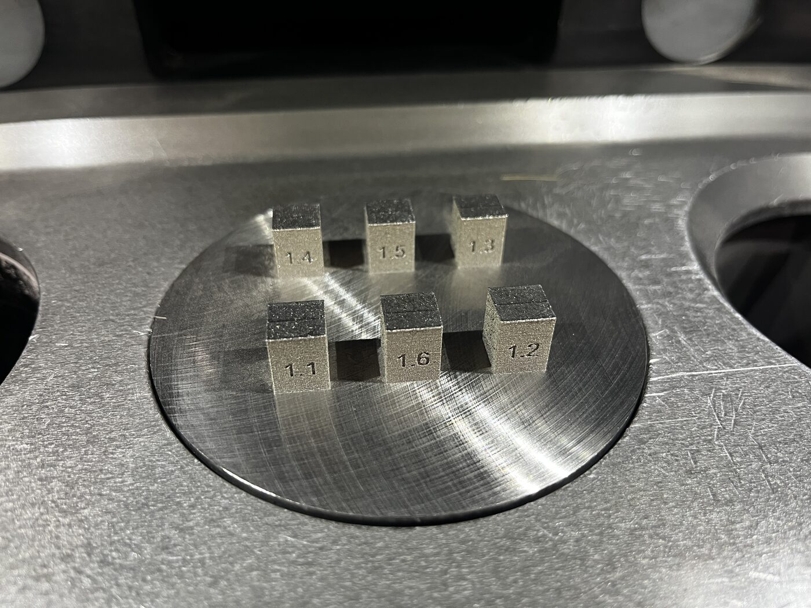
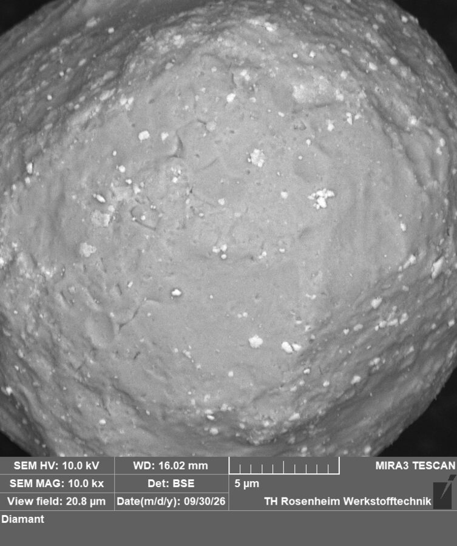
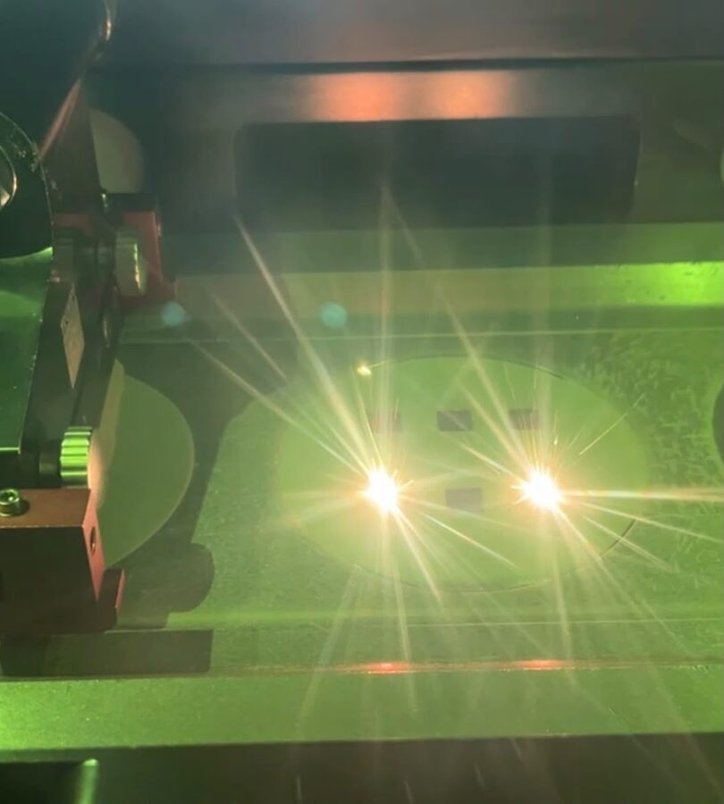

# Microstructural Refinement of LPBF 316L Steel via Rare-Earth Oxide Inoculants

**Master's thesis · TH Rosenheim · submitted October 2026**
Examiners: Prof. Dr. Amber Schneeweis, Prof. Dr.-Ing. Fabian Riß

[English](#english) · [Deutsch](#deutsch)

---

## English

### The problem
Laser powder bed fusion (LPBF) of 316L stainless steel produces coarse, column-shaped grains that grow along the build direction. Adding ceramic particles ("inoculants") is one way to refine them. Rare-earth oxides work as grain refiners in casting, but in LPBF the results are inconsistent, the milling routes used to add them vary widely, and **Y₂O₃ and CeO₂ had never been compared under identical conditions**.

### What I did
1. **Developed a powder-mixing route.** Screened five planetary ball-milling set-ups (zirconia vs. hardened-steel media, 0.5 and 1 mm balls, ball-to-powder ratio 1:1 to 3:1) with 0.7 wt.% Y₂O₃, judged by SEM dispersion and shear-cell flowability. Trials were run at the FRITSCH lab in Idar-Oberstein.
2. **Prepared three inoculated powders**: 0.3 and 0.7 wt.% Y₂O₃, 0.3 wt.% CeO₂, plus baseline 316L.
3. **Printed all four conditions together** on a TRUMPF TruPrint 1000 at a fixed volumetric energy density of 100 J/mm³.
4. **Characterised the samples**: optical microscopy, porosity analysis, SEM with EDX, Vickers hardness (HV5) with Welch ANOVA, EBSD in progress.

### Key results
| Finding | Detail |
|---|---|
| Milling route selected | Hardened-steel media at BPR 3:1 was the only set-up with valid flowability values at all consolidation stresses (ffc = 16.4) |
| Powders stayed printable | All inoculated powders remained free-flowing (ffc₁ 14.5–55.5 vs. 31.2 as-received) |
| Hardness unchanged | 212.7–215.3 HV5 vs. 214.8 HV5 baseline; not significant (p = 0.35); any real effect is below ~4 % |
| Process limit found | 0.7 wt.% Y₂O₃ caused lack-of-fusion porosity at unchanged parameters |
| Contamination traced | Yttrium found in CeO₂ samples was traced to residue on the milling balls |
| Lesson for design | Smallest balls are not automatically best: 0.5 mm zirconia gave the poorest dispersion because of lower impact energy |

**Conclusion:** up to 0.7 wt.% and with unchanged process parameters, neither oxide gave measurable strengthening. Finer dispersion and adapted laser parameters are needed, which sets clear next steps for future work.

| SEM: CeO₂-coated 316L powder | Bright red emission while printing Y₂O₃ powders |
|---|---|
|  |  |

### Skills shown
`LPBF` `TruPrint 1000` `powder processing` `planetary ball milling` `design of experiments` `flowability testing` `metallography` `SEM/EDX` `EBSD` `hardness testing` `Welch ANOVA` `technical writing`

*The full thesis is not public.*

---

## Deutsch

### Fragestellung
Beim Laserstrahlschmelzen (LPBF) von 316L entstehen grobe, stängelförmige Körner entlang der Baurichtung. Keramische Partikel (Impfmittel) können das Gefüge verfeinern. Seltenerdoxide sind aus dem Gießen bekannt, in LPBF sind die Ergebnisse jedoch widersprüchlich, und **Y₂O₃ und CeO₂ wurden bisher nicht unter gleichen Bedingungen verglichen**.

### Vorgehen
1. **Entwicklung des Mischprozesses**: fünf Planetenkugelmühlen-Konfigurationen (Zirkonoxid vs. gehärteter Stahl, 0,5 und 1 mm Kugeln, Kugel-Pulver-Verhältnis 1:1 bis 3:1) mit 0,7 Gew.-% Y₂O₃, bewertet über REM-Dispersion und Scherzellen-Fließfähigkeit; Versuche im FRITSCH-Labor in Idar-Oberstein.
2. **Herstellung von drei geimpften Pulvern**: 0,3 und 0,7 Gew.-% Y₂O₃, 0,3 Gew.-% CeO₂, dazu 316L als Referenz.
3. **Gemeinsamer Druck aller vier Varianten** auf einer TRUMPF TruPrint 1000 bei 100 J/mm³.
4. **Charakterisierung**: Lichtmikroskopie, Porosität, REM/EDX, Vickers-Härte (HV5) mit Welch-ANOVA, EBSD in Arbeit.

### Ergebnisse
- Gehärteter Stahl bei 3:1 als einzige Konfiguration mit gültigen Fließwerten ausgewählt
- Alle geimpften Pulver blieben frei fließend
- Keine Härteänderung (212,7–215,3 HV5 vs. 214,8 HV5; p = 0,35)
- 0,7 Gew.-% Y₂O₃ führte zu Bindefehlern
- Yttrium in den CeO₂-Proben auf Rückstände an den Mahlkugeln zurückgeführt

**Fazit:** Bis 0,7 Gew.-% und mit unveränderten Parametern keine messbare Verfestigung. Feinere Dispersion und angepasste Prozessparameter sind nötig.
